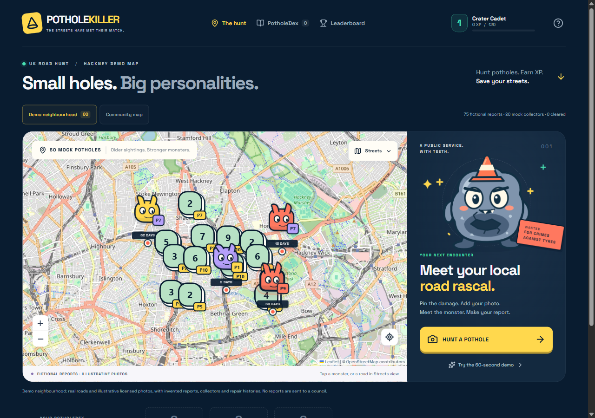
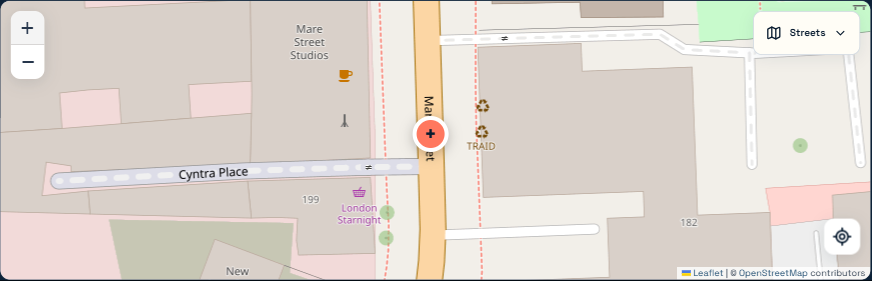
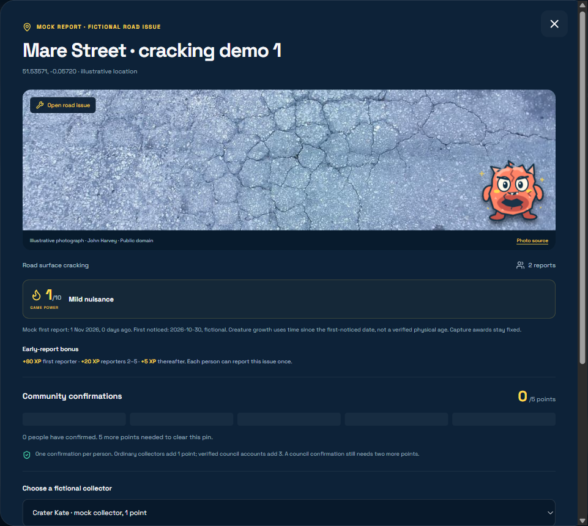
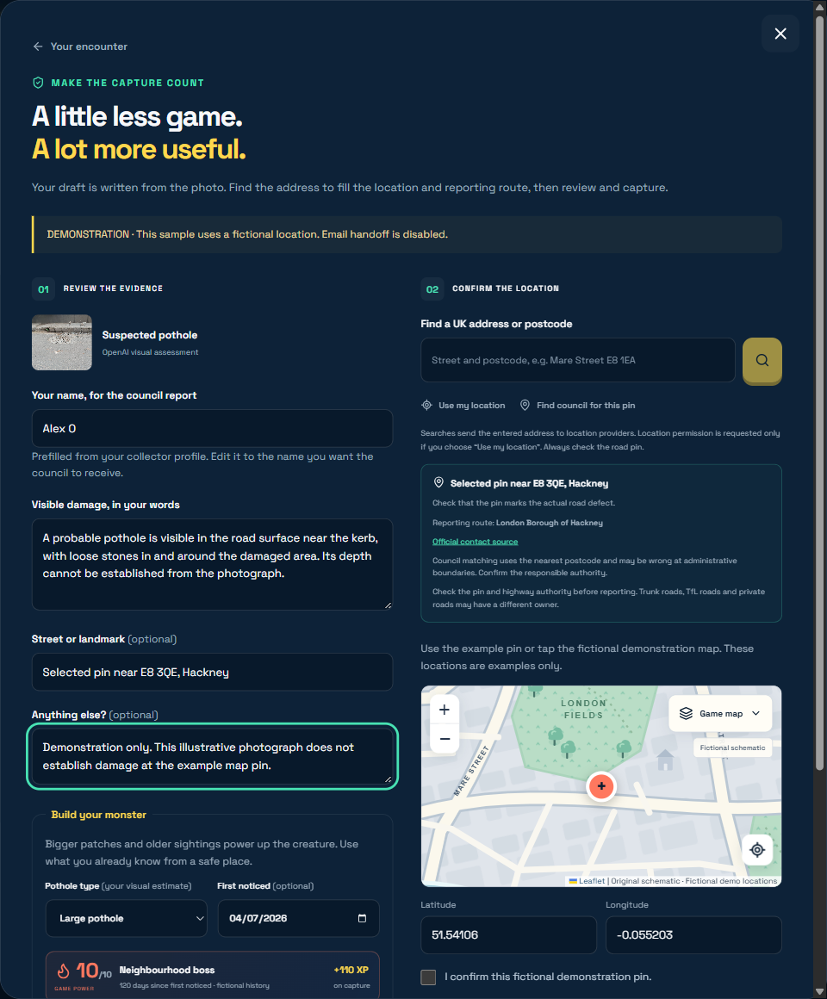
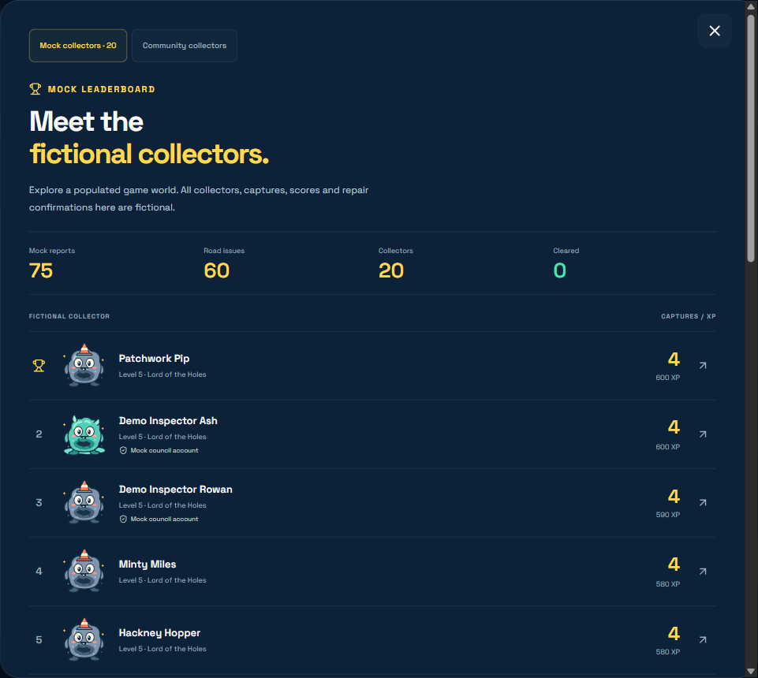

# PotholeKiller

**Hunt potholes. Earn XP. Save your streets.**

A monster-collecting game that helps UK residents turn road damage into useful reports.
Choose the road point, photograph the problem, review the evidence and collect a creature.

**[Open the app](https://potholekiller-hackney.netlify.app)** ·
**[Watch the 48-second community demo](https://github.com/ShabalalaWATP/PotholeKiller/releases/download/hackathon-community-2026/potholekiller-community-demo.webm)** ·
[Video release](https://github.com/ShabalalaWATP/PotholeKiller/releases/tag/hackathon-community-2026)



*The demonstration places fictional road monsters on real Hackney street geometry.*

## Four steps from pothole to report

1. **Find it.** Search a UK address or postcode, zoom in and confirm the exact road point before taking a real photo.
2. **Meet it.** OpenAI checks the photograph for visible road damage and reveals an original creature. Unrelated images earn no capture.
3. **Review it.** Correct the description, check the reporter name and reporting route, then prepare the draft.
4. **Collect it.** Earn XP and keep the creature/report in your PotholeDex. You choose whether to publish a road pin or open an official reporting channel.

Existing monsters open details showing their self-reported age, linked report count and community repair status,
with an option to add your own report.

## What makes it useful, and fun

- **Precise geographic maps:** Streets and Night views, clustered monsters and a close-zoom anchor for placing the road point.
- **Real visual analysis:** the server-side OpenAI Responses API returns structured observations, separate from the creature's nickname and humour.
- **A draft you can use:** UK address/authority lookup, editable findings and reporter name, coordinates, copy and reporting handoff.
- **Original creatures and progression:** apparent extent and first-noticed date affect game power, capture XP and artwork.
- **Early-reporter and repair rewards:** once-only bonuses, weighted community marking and matching reporter credits.
- **Collector profiles:** local nickname/avatar and PotholeDex, with optional Netlify sign-in, opt-in public pins and shared scores.

Each photo earns **60–110 capture XP**. On a shared pothole, the first reporter gets **+60 community XP**,
reporters 2–5 get **+20**, and later reporters get **+5**, once per person per issue.
Repair marking needs five points: verified council accounts contribute three and other collectors contribute one.
Reaching the threshold awards the original reporters their capture XP and reporting bonus again, once.

Game power is not an engineering danger rating. Community-marked fixed is a voting status, not proof of council repair.
Only Hackney has a verified direct email enabled; other authorities use verifiable official forms or national fallback routes.
You review and send official reports yourself, attaching the photograph where required. The app never sends one automatically.

## A closer look

### Place the road point



*Close geographic zoom lets you place and confirm the point on the road. Address suggestions still need your review.*

### Inspect the creature



*An original monster brings together the issue's observations, report history and community actions.*

### Review the named report



*The draft is written from the findings and chosen location. The reporter name is editable and omitted from the public road API.*

### Join the demo league



*The twenty-user demo league and repair simulation are fictional. They are separate from authenticated community records.*

The default demo contains 60 fictional issues and 75 mock report links. Its licensed example photographs are
not evidence of damage at the London demo pins. Predefined scan output is explicitly labelled;
bundled examples cannot email a council or earn real community credit.

## Run locally

Use **Node.js 22.12.0 or later** and npm.

```powershell
git clone https://github.com/ShabalalaWATP/PotholeKiller.git
cd PotholeKiller
npm ci
Copy-Item .env.example .env.local
```

On macOS/Linux, use `cp .env.example .env.local` for the copy step.

Edit the ignored `.env.local` file privately:

| Variable | Purpose |
| --- | --- |
| `OPENAI_API_KEY` | Your server-side key for live image analysis. |
| `APP_ORIGIN` | Set to `http://127.0.0.1:3000` locally, or the canonical public origin when hosting. |
| `OPENAI_MODEL` | Optional model override; the application defaults to `gpt-6.1-terra`. |

The example environment file contains variable names only. Never commit a real key or put it in a `NEXT_PUBLIC_` variable.
The labelled sample journey works without a key. Other optional limits are listed in [.env.example](.env.example).

```powershell
npm run dev
```

Open [http://127.0.0.1:3000](http://127.0.0.1:3000). To build and run the production application locally:

```powershell
npm run build
npm run start
```

For automated lint, type and test checks, run `npm run check`.

Guest play works locally. Optional shared accounts, database-backed scores and public-road features use the hosted Netlify services.

## Technology and hosting

| Part | Technology |
| --- | --- |
| Application | Next.js 16 App Router, React 19, TypeScript, Tailwind CSS |
| Vision | Official OpenAI SDK, Responses API, Structured Outputs and Zod |
| Maps and lookup | React Leaflet, OpenStreetMap, Photon, Postcodes.io and official UK authority routes |
| Artwork and images | Original SVG/CSS creatures, licensed example photos and sharp image processing |
| Optional community | Official Netlify Identity SDK, native Netlify Functions and Netlify Database/Postgres |
| Hosting | Netlify with the official Next.js Runtime 5.16 |

The Netlify build pipeline runs the application build, packages native functions and stages the committed
database migrations. Configure the server environment for live AI; shared features also need Identity and Database.
Production uses its canonical `APP_ORIGIN`, while Netlify's `DEPLOY_PRIME_URL` supports preview origins.
See [hosting configuration](netlify.toml), [database migrations](netlify/database/migrations),
and [community setup](docs/COMMUNITY_SETUP.md) for deployment and account details.

## Credits and further detail

Built by **Alex O, solo**, for the DevDay Exchange Community Hackathon, London, 1 November 2026.
Codex helped implement the vision endpoint, reviewed reporting flow, game rules and community features.
[Codex contribution evidence](CODEX_BUILD_NOTES.md) links the implementation and delivery record.

See [asset credits](docs/ASSET_CREDITS.md), [demo-data credits](docs/DEMO_DATA_CREDITS.md),
[lookup provenance and directory licence](lib/location/README.md),
[privacy/security notes](docs/security/SECURITY_NOTES.md) and [community repair rules](docs/COMMUNITY_REPAIRS.md).
Maps credit [OpenStreetMap contributors](https://www.openstreetmap.org/copyright).

**Stay safe. Never enter the road or stop somewhere dangerous to photograph a pothole.**
